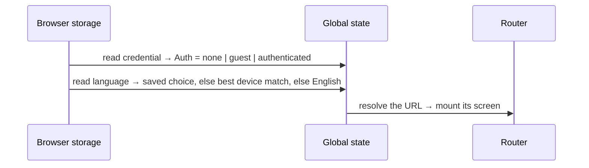
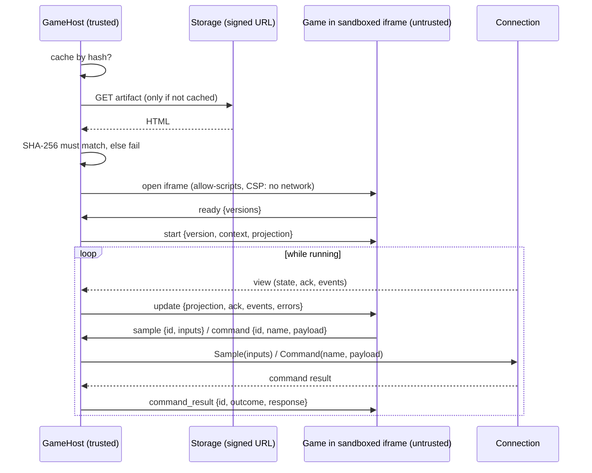

# Frontend Flows

Status: MIRRORS THE CODE (2026-10-20) — see [README.md](README.md) for how it is kept in sync

What happens, step by step, in every flow built so far: external calls, what is done with each answer, global vs. feature state, and navigation. The same logic as Go-style pseudocode, to trace by hand: start at [mirror/routes.go](mirror/routes.go).

## Where state lives

| Where | What | Lifetime | Mirror |
| --- | --- | --- | --- |
| **Browser storage** (localStorage) | `playhoot.credential.v1` (token, userUUID, kind, displayName) · `playhoot.locale.v1` (chosen language) · `playhoot.sound.v1` (on/off) | Until the person clears site data | [state_app.go](mirror/state_app.go) |
| **Global state** | `Auth` (unknown / none / guest / authenticated + userUUID + displayName) · `Locale` | The open tab | [state_app.go](mirror/state_app.go) |
| **Feature state** (Join Session) | `Target` (from the URL) · `SessionUUID` (learned) · `View` (the current phase) | While a Session route is open; discarded when leaving it | [state_joinsession.go](mirror/state_joinsession.go) |
| **Browser Cache Storage** | `playhoot-game-artifacts-v1`: verified game artifacts by SHA-256 | Until the person clears site data (content never changes for a hash) | [state_gamehost.go](mirror/state_gamehost.go) |
| **GameHost state** | phase (loading / starting / running / failed / disposed) · the iframe · game sample ids ↔ connection sequences | One game run; disposed with its screen | [state_gamehost.go](mirror/state_gamehost.go) |
| **Connection state** | sample sequence · the player's game state rebuilt from views · pending commands | One WebSocket; a reconnection starts a new one from zero | [state_connection.go](mirror/state_connection.go) |
| **Component state** | Enter a code: the code being typed · Name step: the name being typed · Lobby: "link copied" flag | While the component is on screen | the screen's `view_*.go` |

Rule of the architecture: nothing of a feature survives leaving its route. Coming back rebuilds it from the URL plus the backend.

## External calls so far

| When | Call | With | Answer used for |
| --- | --- | --- | --- |
| Name submitted (no identity yet) | `POST /v1/guests` | `display_name`, `idempotency_key` | `user_uuid` + `token` → stored as the credential |
| Joining, by code | WebSocket `/v1/play/join/{joinCode}` | token in subprotocol | Opening it IS joining; then server messages |
| Joining / reconnecting, by Session | WebSocket `/v1/play/join/sessions/{sessionUUID}/player` | token in subprotocol | Same |
| A game is about to run (not yet wired to a screen) | `GET` the signed artifact URL from `session_started` (storage, not the backend API) | no credentials | The game's HTML, accepted only if its SHA-256 matches; cached by hash so later loads skip the network |
| Leaving | `{"type":"leave"}` on the WebSocket | — | Server answers `leave_result` and closes as `left` |
| Playing (ready, not used by any screen yet) | `sample` / `command` / `resync` on the WebSocket | inputs / name+payload+token | views, `command_result` |

---

## 1. Opening the app (any URL)



No network call: the stored credential is trusted locally until a backend call rejects it (flow 10).

## 2. Enter a code → a join link

There is no home page yet (it comes late): `/` only redirects (**replace**) to `/join`, the Enter a code screen.

1. The person types the code. Component state: `Code` (only valid letters, uppercased, max 6).
2. With 6 characters, "Unirme" / "Join" navigates (**push**) to `/join/{CODE}`.

A join link opened directly (shared by someone) skips this screen and starts at flow 3.

## 3. Joining by code

The Session route creates the feature from the URL: `Target = {joinCode}`, `View = connecting`, then `Start()`:

```mermaid
sequenceDiagram
  participant U as Person
  participant F as Join feature
  participant G as Global state
  participant API as Backend
  F->>G: Auth?
  alt no identity (first visit)
    F->>U: View = identity ("What should we call you?")
    U->>F: SubmitDisplayName("Ana")
    Note over F: rule: 1–64 chars, else error without calling the backend
    F->>API: POST /v1/guests {display_name, idempotency_key}
    API-->>F: 201 {user_uuid, token}
    F->>G: SignIn(credential) → Auth = guest; saved to browser storage
  else already guest/authenticated (later visits)
    Note over F: no name asked
  end
  F->>API: WebSocket /v1/play/join/{code} (token in subprotocol)
  F->>U: View = connecting
  API-->>F: lobby_update {session_uuid, members}
  F->>F: SessionUUID = session_uuid; View = lobby(members, IsYou marked)
  Note over F,U: Router REPLACES the URL with /sessions/{uuid}/play (same feature, same connection)
```

Errors of `POST /v1/guests` stay in the name step: `400` → "that name can't be used", `rate_limited` → "wait N seconds", anything else → "couldn't reach Playhoot". The idempotency key is reused if the same name is submitted again, so a retry never creates two guests.

## 4. In the lobby

| Server sends | Feature state | Screen reaction |
| --- | --- | --- |
| `lobby_update` (another player joined or left) | `Members` replaced by the new list | List updates; count bumps; join/leave sound |
| `session_started` | `View = started` (roster, your participant id, the game's frontend URL) | "Game on!" (Session Play takes over in a later step) |
| `lobby_closed` / `session_ended` | `View = closed(ended, status, cause)` | Ending screen (flow 9) |

"Copy invite link" copies `/join/{CODE}` when the person came with a code, else `/sessions/{uuid}/play`. No navigation, no call.

## 5. The game starts

`session_started` → `View = started`, `SessionUUID` confirmed. From here the connection also delivers `player_view` messages; the Join feature ignores them. The realtime client already rebuilds the player's state from them (flow 11); the game screen that uses it is a later step.

## 6. Connection lost (any phase)

```mermaid
sequenceDiagram
  participant F as Join feature
  participant API as Backend
  API--xF: socket closes (network, server restart, 1011/1012…)
  F->>F: View = connecting(attempt 1); wait 1 s
  F->>API: WebSocket /v1/play/join/sessions/{uuid}/player
  alt back within the backend's 3 s grace (running game)
    API-->>F: session_started + FULL view (silent reattach)
  else in the lobby
    API-->>F: lobby_update (a fresh lobby join)
  else fails again
    F->>F: attempt 2 (wait 2 s), attempt 3 (wait 4 s)
    F->>F: View = closed(connection-lost) → "Try again" restarts at Start()
  end
```

Reconnection always uses the Session UUID once it is known (the code stops working when the game starts). It never reconnects after `replaced` (the same player opened the game elsewhere).

## 7. Refreshing the page

The URL is already `/sessions/{uuid}/play`, so a refresh runs flow 1 (identity from storage) then flow 3 by Session UUID: the backend reattaches the player (or rejoins, or rejects if the game no longer allows them).

## 8. Leaving

"Leave game" → `View = leaving`, sends `{"type":"leave"}` → server closes as `left` → `View = closed(left)` → navigation to `/join` (**push**). Navigating away without pressing it only closes the socket (in a lobby that also removes the player).

## 9. How a join can end

| Cause | Feature state | Next actions offered |
| --- | --- | --- |
| First handshake failed (wrong/expired code, auth, limits, Session not joinable — the browser cannot tell which) | `closed(unreachable)` | Enter a code · Try again |
| `rejected` (`lobby_full`, `session_started`, `session_unavailable`, `participant_disconnected`, `rejoin_rejected`, `server_busy`…) | `closed(rejected, reason)` | Depends on the reason |
| `lobby_closed` / `session_ended` | `closed(ended, status, cause)` | Enter a code |
| Closed as `replaced` | `closed(replaced)` | Play here (reconnects, taking over) · Enter a code |
| 3 reconnections failed | `closed(connection-lost)` | Try again · Enter a code |
| A message breaks the protocol | `closed(protocol-error)` | Try again · Enter a code |

"Try again" / "Play here" = `Retry()` → `Start()` again (same URL). "Enter a code" navigates to `/join`.

## 10. A stored credential stops working

Any HTTP call that carried a token and gets `401 token_invalid` → `SignOut()`: credential removed from storage, `Auth = none`. The next join asks for a name again. (A refused WebSocket handshake is invisible to the browser, so it shows as "unreachable".)

## 11. Playing (client ready, no screen yet)

Built into the connection, waiting for the game screen (plan steps 4–6):

- **Inputs**: `Sample(inputs)` → `{"type":"sample","sequence":n,"inputs"}`, numbered 1, 2, 3… per connection, at most 60 per second (faster calls keep only the latest snapshot).
- **Views**: `player_view` FULL replaces the state; a patch is merged into it; a view with the same revision only brings a new ack/events/errors; a missing revision → the state is untrusted and one `resync` is sent; the next FULL repairs it. Verified against the real backend.
- **Commands**: `Command(name, payload)` → `{"type":"command","token",...}` → waits for `command_result` with that token. `rate_limited` → resent with the same token (250 ms, 500 ms, 1 s). Connection closed first → `connection-closed`, retryable later with the same token (never runs twice).

## 12. Running a game (GameHost, not yet on a screen)

Built and verified in the dev lab `/dev/game-host` (fake Session); Session Play (plan step 6) will start it after `session_started`. Bridge contract: ADR-0005 (PROPOSED). Pseudocode: [state_gamehost.go](mirror/state_gamehost.go).



- **Failures** (the game stops, its iframe is removed): artifact unreachable (network, CORS, expired URL), hash mismatch, no `ready` within 10 s, no common bridge version, the game navigating its frame.
- **Refused game messages** (wrong shape, too big, before `ready`, sample ids not growing, a second `ready`) are dropped and recorded; the game keeps running.
- The game never gets the token, the WebSocket, the signed URL, command tokens or connection sample numbers: its acks come back in its own sample numbering.

## 13. Preferences

| Control | Call | State |
| --- | --- | --- |
| Language picker | none | `Locale` (global) + browser storage; every text switches at once |
| Sound button | none | mute flag + browser storage (presentation only) |
