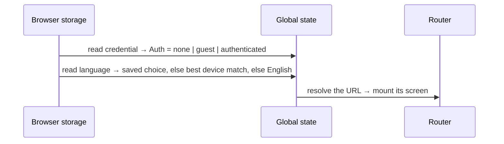
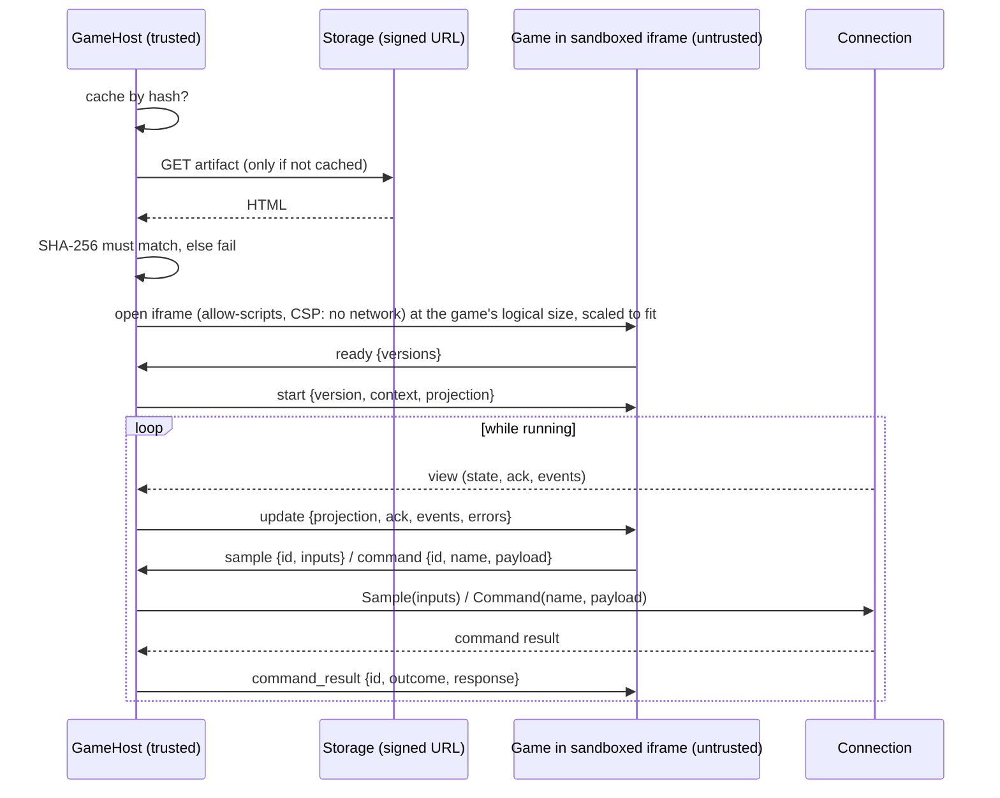

# Frontend Flows

Status: MIRRORS THE CODE (2026-10-20, Session Play) — see [README.md](README.md) for how it is kept in sync

What happens, step by step, in every flow built so far: external calls, what is done with each answer, global vs. feature state, and navigation. The same logic as Go-style pseudocode, to trace by hand: start at [mirror/routes.go](mirror/routes.go).

## Where state lives

| Where | What | Lifetime | Mirror |
| --- | --- | --- | --- |
| **Browser storage** (localStorage) | `playhoot.credential.v1` (token, userUUID, kind, displayName) · `playhoot.locale.v1` (chosen language) · `playhoot.sound.v1` (on/off) | Until the person clears site data | [state_app.go](mirror/state_app.go) |
| **Global state** | `Auth` (unknown / none / guest / authenticated + userUUID + displayName) · `Locale` | The open tab | [state_app.go](mirror/state_app.go) |
| **Feature state** (Join Session) | `Target` (from the URL) · `SessionUUID` (learned) · `View` (the current phase; during a game also `Connection`: connected / reconnecting) · the live link to the current connection | While a Session route is open; discarded when leaving it | [state_joinsession.go](mirror/state_joinsession.go) |
| **Feature state** (Session Play) | the game's GameHost status · refused game messages | One started game (kept across reconnections); discarded when the game screen goes away | [state_sessionplay.go](mirror/state_sessionplay.go) |
| **Browser Cache Storage** | `playhoot-game-artifacts-v1`: verified game artifacts by SHA-256; `playhoot-game-assets-v1`: verified game assets by SHA-256 | Until the person clears site data (content never changes for a hash) | [state_gamehost.go](mirror/state_gamehost.go) |
| **GameHost state** | phase (loading / starting / running / failed / disposed) · the iframe · game sample ids ↔ connection sequences | One game run; disposed with its screen | [state_gamehost.go](mirror/state_gamehost.go) |
| **Connection state** | sample sequence · the player's game state rebuilt from views · pending commands | One WebSocket; a reconnection starts a new one from zero | [state_connection.go](mirror/state_connection.go) |
| **Component state** | Enter a code: the code being typed · Name step: the name being typed · Lobby: "link copied" flag | While the component is on screen | the screen's `view_*.go` |

Rule of the architecture: nothing of a feature survives leaving its route. Coming back rebuilds it from the URL plus the backend.

## External calls so far

| When | Call | With | Answer used for |
| --- | --- | --- | --- |
| Name submitted (no identity yet) | `POST /v1/guests` | `display_name`, `idempotency_key` | `user_uuid` + `token` → stored as the credential |
| Joining, by code | WebSocket `/v1/play/join/{joinCode}` | token in subprotocol | Opening it IS joining; then server messages |
| Joining / reconnecting, by Session | WebSocket `/v1/play/join/sessions/{sessionUUID}/player` | token in subprotocol | Same |
| The game screen opens (only when the artifact is not cached yet) | `GET` the signed artifact URL from `session_started` (storage, not the backend API) | no credentials | The game's HTML, accepted only if its SHA-256 matches; cached by hash so later loads skip the network |
| The game loads a declared asset (only when not cached yet) | `GET` the asset's signed URL from `session_started.frontend.assets` (storage) | no credentials | The bytes, accepted only if size and SHA-256 match; cached by hash |
| Leaving | `{"type":"leave"}` on the WebSocket | — | Server answers `leave_result` and closes as `left` |
| Playing (the game asks through the GameHost) | `sample` / `command` / `resync` on the WebSocket | inputs / name+payload+token | views → the game; `command_result` → the game |
| The GameHost stops the game (any failure, flow 12) | `{"type":"game_fault"}` on the WebSocket | kind + evidence (≤ 2 KiB) | Nothing: never answered; the backend stores it for auditing |
| Every 30 s while there is telemetry, and when the tab is hidden or closed (flow 14) | `POST /v1/client-telemetry` | the classified events, in one batch | Nothing (`204`); the backend records them as metrics |

---

## 1. Opening the app (any URL)



No network call: the stored credential is trusted locally until a backend call rejects it (flow 10).

## 2. Enter a code → a join link

There is no home page yet (it comes late): `/` only redirects (**replace**) to `/join`, the Enter a code screen.

1. The person types the code. Component state: `Code` (only valid letters, uppercased, max 6).
2. With 6 characters, "Unirme" / "Join" navigates (**push**) to `/join/{CODE}`.

A join link opened directly (shared by someone) skips this screen and starts at flow 3.

## 3. Joining by code

The Session route creates the feature from the URL: `Target = {joinCode}`, `View = connecting`, then `Start()`:

```mermaid
sequenceDiagram
  participant U as Person
  participant F as Join feature
  participant G as Global state
  participant API as Backend
  F->>G: Auth?
  alt no identity (first visit)
    F->>U: View = identity ("What should we call you?")
    U->>F: SubmitDisplayName("Ana")
    Note over F: rule: 1–64 chars, else error without calling the backend
    F->>API: POST /v1/guests {display_name, idempotency_key}
    API-->>F: 201 {user_uuid, token}
    F->>G: SignIn(credential) → Auth = guest; saved to browser storage
  else already guest/authenticated (later visits)
    Note over F: no name asked
  end
  F->>API: WebSocket /v1/play/join/{code} (token in subprotocol)
  F->>U: View = connecting
  API-->>F: lobby_update {session_uuid, members}
  F->>F: SessionUUID = session_uuid; View = lobby(members, IsYou marked)
  Note over F,U: Router REPLACES the URL with /sessions/{uuid}/play (same feature, same connection)
```

Errors of `POST /v1/guests` stay in the name step: `400` → "that name can't be used", `rate_limited` → "wait N seconds", anything else → "couldn't reach Playhoot". The idempotency key is reused if the same name is submitted again, so a retry never creates two guests.

## 4. In the lobby

| Server sends | Feature state | Screen reaction |
| --- | --- | --- |
| `lobby_update` (another player joined or left) | `Members` replaced by the new list (with each one's display name) | List updates with names; count bumps; join/leave sound |
| `session_started` | `View = started` (roster with names, your participant id, the game's frontend URL) | The game screen (flow 5) |
| `lobby_closed` / `session_ended` | `View = closed(ended, status, cause)` | Ending screen (flow 9) |

"Copy invite link" copies `/join/{CODE}` when the person came with a code, else `/sessions/{uuid}/play`. No navigation, no call.

## 5. The game starts

`session_started` → `View = started` (`Connection = connected`), `SessionUUID` confirmed. The game screen opens and creates Session Play, which runs the game (flow 12): it loads the frontend named in `session_started`, starts it in its sandboxed iframe, and from then on the views go to the game and the game's inputs and commands go to the backend. Verified end to end against the real backend on 2026-10-20 with Space Drift.

**Players list during the game.** The seat chip ("Jugador 2 de 3") opens the list of players. Each one shows their name (the one typed on this device for its owner, else the backend's display name, else "Jugador N") and their status: `roster_update` arrives after `session_started` and whenever someone's presence changes, and replaces each participant's status: playing, reconnecting (lost their connection, inside the backend's 3 s grace), disconnected (the grace ran out) or left (pressed Leave). Verified 2026-10-20, end to end against the real backend in two headless Edge browsers: names in both lobbies, and the other player shown as "Salió de la partida" after leaving.

## 6. Connection lost (any phase)

```mermaid
sequenceDiagram
  participant F as Join feature
  participant API as Backend
  API--xF: socket closes (network, server restart, 1011/1012…)
  F->>F: View = connecting(attempt 1); wait 1 s
  F->>API: WebSocket /v1/play/join/sessions/{uuid}/player
  alt back within the backend's 3 s grace (running game)
    API-->>F: session_started + FULL view (silent reattach)
  else in the lobby
    API-->>F: lobby_update (a fresh lobby join)
  else fails again
    F->>F: attempt 2 (wait 2 s), attempt 3 (wait 4 s)
    F->>F: View = closed(connection-lost) → "Try again" restarts at Start()
  end
```

Reconnection always uses the Session UUID once it is known (the code stops working when the game starts). It never reconnects after `replaced` (the same player opened the game elsewhere).

**During a game** the phase stays `started` instead of `connecting`: the game stays on screen with a "Se perdió la conexión. Reconectando…" banner, and is NOT reloaded. When the new connection opens, the GameHost forgets the old sample numbers; the backend's `session_started` + FULL view become the game's new baseline, and the game's last inputs are sent again (the backend reset them when the connection dropped). Verified end to end on 2026-10-20 by cutting the connection mid-game: the banner came and went, the game kept its frame, and a held key kept steering the ship after the reconnection.

## 7. Refreshing the page

The URL is already `/sessions/{uuid}/play`, so a refresh runs flow 1 (identity from storage) then flow 3 by Session UUID: the backend reattaches the player (or rejoins, or rejects if the game no longer allows them). In a running game, `session_started` comes again and the game screen loads the game from the browser's artifact cache (no download, so an expired signed URL does not matter), then the FULL view. Verified end to end on 2026-10-20.

## 8. Leaving

"Leave game" (lobby) or "Salir" / "Leave" (game screen) → `View = leaving`, sends `{"type":"leave"}` → server closes as `left` → `View = closed(left)` → navigation to `/join` (**push**). Navigating away or closing the tab without pressing it only closes the socket: a disconnection, not a leave (decided by the human, 2026-10-21). In a lobby that also removes the player; in a game the backend keeps the seat for 3 s, so reopening the page in time reattaches without the game noticing. Leaving while the game is starting: the backend applies the leave once the start resolves; meanwhile the feature ignores lobby, start and roster messages, so the game is never shown.

## 9. How a join can end

| Cause | Feature state | Next actions offered |
| --- | --- | --- |
| First handshake failed (network, auth, limits, busy server — the browser cannot tell which) | `closed(unreachable)`, shown as the unexpected error | Try again · Enter a code |
| `rejected` — own message only for `invalid_join_code`, `join_code_expired`, `lobby_full`, `session_started` and `participant_disconnected` / `rejoin_rejected`; every other reason (and an unknown one) shows the unexpected error (decided by the human, 2026-10-21): (`invalid_join_code`, `join_code_expired`, `lobby_full`, `session_started`, `session_unavailable`, `participant_disconnected`, `rejoin_rejected`, `server_busy`…) | `closed(rejected, reason)` | Depends on the reason |
| `lobby_closed` / `session_ended` | `closed(ended, status, cause)` | Enter a code |
| Closed as `replaced` | `closed(replaced)` | Play here (reconnects, taking over) · Enter a code |
| 3 reconnections failed | `closed(connection-lost)` | Try again · Enter a code |
| A message breaks the protocol | `closed(protocol-error)`, shown as the unexpected error | Try again · Enter a code |
| The game was stopped for misbehaving (abuse, leaving its container, wrong hash; flow 12) | `closed(game-stopped)`, after reporting it and leaving | Enter a code |
| The game sent data it does not declare (an invalid SAMPLE or COMMAND): the backend records it against the game and closes 1007 `invalid_game_data` | `closed(game-error)`: "Lo sentimos, algo anda mal con este juego", not the player's fault; never reconnected | Enter a code |

"Try again" / "Play here" = `Retry()` → `Start()` again (same URL). "Enter a code" navigates to `/join`.

## 10. A stored credential stops working

Any HTTP call that carried a token and gets `401 token_invalid` → `SignOut()`: credential removed from storage, `Auth = none`. The next join asks for a name again. (A refused WebSocket handshake is invisible to the browser, so it shows as "unreachable".)

## 11. Playing: what the connection does

What the connection does with what the game sends and receives (the game reaches it through the GameHost, flow 12):

- **Inputs**: `Sample(inputs)` → `{"type":"sample","sequence":n,"inputs"}`, numbered 1, 2, 3… per connection, at most 60 per second (faster calls keep only the latest snapshot).
- **Views**: `player_view` FULL replaces the state; a patch is merged into it; a view with the same revision only brings a new ack/events/errors; a missing revision → the state is untrusted and one `resync` is sent; the next FULL repairs it. Verified against the real backend.
- **Commands**: `Command(name, payload)` → `{"type":"command","token",...}` → waits for `command_result` with that token. `rate_limited` → resent with the same token (250 ms, 500 ms, 1 s). Connection closed first → `connection-closed`, retryable later with the same token (never runs twice).

## 12. Running a game (GameHost)

Session Play starts it on the game screen after `session_started` ([state_sessionplay.go](mirror/state_sessionplay.go)); the dev lab `/dev/game-host` also runs it against a fake Session. Bridge contract: ADR-0005. Pseudocode: [state_gamehost.go](mirror/state_gamehost.go). If it fails, the game screen shows why and offers "Intentar de nuevo" (load it again) or leaving.



- **Fixed-aspect viewport** (plan §8): `session_started` says the game's shape (`viewport`: an aspect ratio from the backend's catalog and its logical size, e.g. 16:9 = 1920 x 1080). The game is shown like a picture: whole, as big as fits, centered, never stretched, with bars where space is left. Inside, the game always measures its logical size and touches/clicks arrive in those units, on any device; resizing the window or rotating the phone changes only the scale. On a touch device that is not a wide screen and is held the other way from the game, a dismissable hint suggests turning it (never for a square game).
- **Failures** (the game stops, its iframe is removed): artifact unreachable (network, CORS, expired URL), hash mismatch, no `ready` within 10 s, no common bridge version, the game navigating its frame or opening a frame, the game abusing the bridge.
- **Refused game messages** (wrong shape, too big, before `ready`, sample ids not growing, a second `ready`) are dropped and recorded; the game keeps running.
- **Assets** (ADR-0008): the game declares every asset once (`playhoot.assets({ship: 'image'})`: image, audio or video) and loads them by those handles. `session_started` lists the version's assets with signed URLs that outlive the Session (shared by every Session of the version, signed in one batch with the HTML). The GameHost downloads one only when the game asks for it and it is not cached, checks size and hash, keeps it by hash, and moves the bytes into the frame; the game gets a local `blob:` URL. A key the backend did not list, or bytes of another type than declared, are refused. The SDK sends asset requests under the limits below, so preloading many assets is never abuse.
- **Message limits** (ADR-0006): the GameHost counts every game message before reading it (all 240/s, samples 120/s, commands and asset requests 20/s, at most 16 commands and 8 asset requests waiting). Extra messages are dropped; a game still over its limits after 5 seconds in a row is stopped ("the game has a problem").
- **Isolation** (ADR-0006): the game cannot navigate its frame anywhere (the page forbids it), has no WebRTC, and any frame it tries to open is removed and stops it. Best effort against leaking the player's own view.
- **Reported to the backend**: every stop (any failure above) sends `game_fault` with the kind and its evidence, so the backend can audit games with problems and tell a bad game from a lying client. The backend also records every limit its own side enforced on the player, next to it.
- **Suspicious stops end the player's game** (abuse, leaving its container, wrong hash): after the report the player leaves the Session and sees "El juego tuvo un problema" / "The game had a problem" / "O jogo teve um problema", with only "Enter a code". Other failures keep "Try again".
- The game never gets the token, the WebSocket, the signed URL, command tokens or connection sample numbers: its acks come back in its own sample numbering.

## 13. Preferences

| Control | Call | State |
| --- | --- | --- |
| Language picker | none | `Locale` (global) + browser storage; every text switches at once |
| Sound button | none | mute flag + browser storage (presentation only) |

## 14. Telemetry (what the platform sees)

ADR-0007. While the app runs, the features say what happened (connections closing, reconnections, resyncs, how a join ended, load and READY times of the game, game messages refused, GameHost failures) and the route error boundary says when a screen crashed. One module classifies them into the backend's catalog, every error with its origin (presentation, bridge, transport, backend rejection, artifact): [external.go](mirror/external.go) `TelemetryEvent`. They wait in a queue, the same ones merged with a count, and leave in one batch every 30 s (sooner when 50 wait, and once more when the tab is hidden or closed), only once the person has an identity. Nothing on screen changes; a batch that fails is lost. In development every event is also printed to the console (`[telemetry]`).
